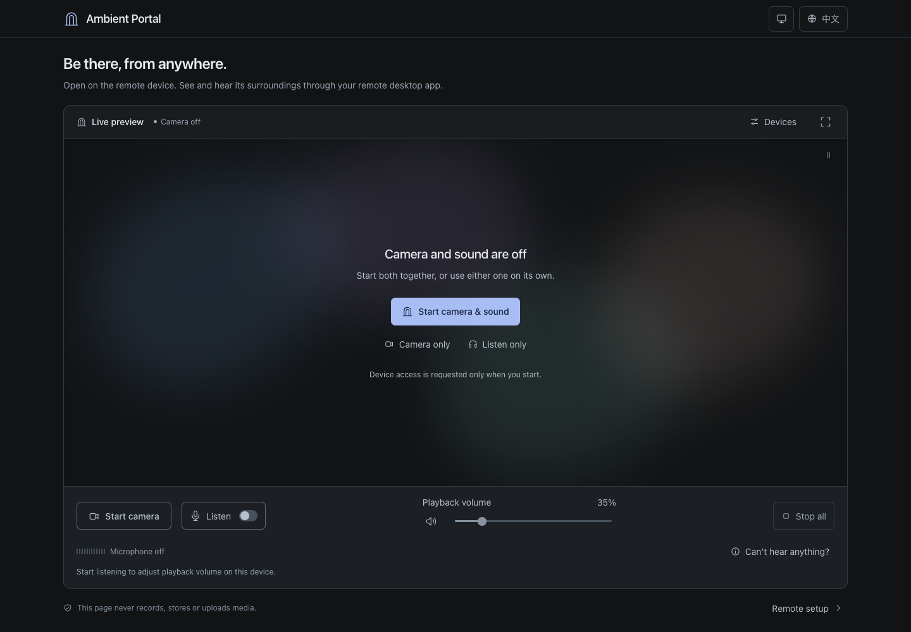
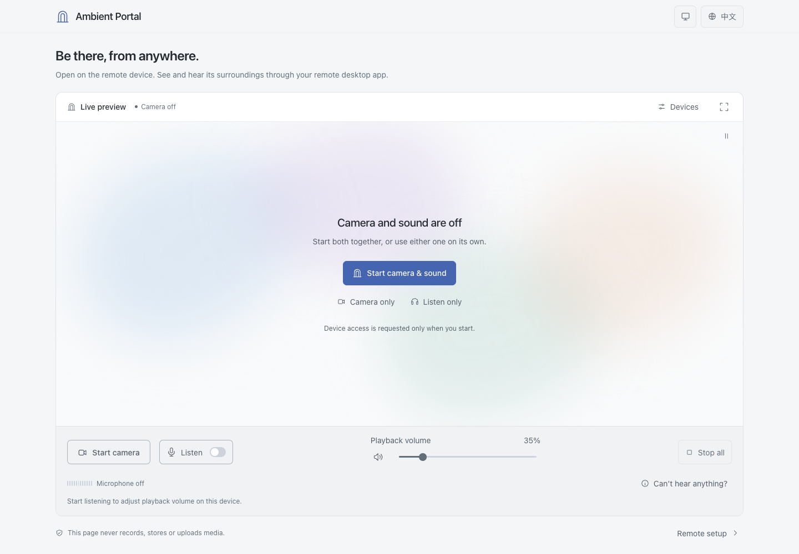

# Ambient Portal

**Be there, from anywhere.**

English · [简体中文](README.md)

[Open the app](https://hanglark.github.io/ambient-portal/) · [GitHub repository](https://github.com/HangLark/ambient-portal)



<details>
<summary>Preview the light theme</summary>



</details>

Ambient Portal (**遥·窗** in Simplified Chinese) is a lightweight, browser-only window into the environment around a device. Open it on a computer you control remotely to preview its camera and play its microphone through the local browser. A remote desktop app such as UU Remote forwards the screen and system audio to your other device.

Built with Vite, vanilla JavaScript, and native browser APIs. The core app has no backend, accounts, database, or runtime npm dependencies. No media recording, storage, or uploading. Only language, appearance, background motion, aspect ratio, and playback reminder preferences persist in this browser’s `localStorage`.

## Features

- Direct camera preview and fullscreen viewing. Prefers the highest available native resolution, then the highest frame rate at that resolution, with actual capture settings displayed.
- Auto, 16:9, 4:3, 1:1, and 9:16 aspect ratio negotiation. Native formats come first; unavailable formats keep the working picture, with an explicit option to allow cropping.
- **Start camera & sound** starts both inputs in one action. Camera and microphone remain independent: one can keep working if the other fails. One action stops everything; reloading or leaving releases media tracks.
- The preview fills the remaining window height, with a shared control bar in desktop, phone, and fullscreen views. **Camera only** and **Listen only** are also available from the initial view.
- **Device settings** identifies the actual camera and microphone, with independent selection when multiple authorized inputs are available.
- An audio-only view with real input levels. **Can’t hear anything?** traces microphone input, browser playback, and remote audio forwarding.
- Sound checks suggest the next step for the current state, with actions to start listening, resume paused playback, or restore muted volume to the default 35%.
- Microphone capture prefers the highest available sample rate, bit depth, and channel count, showing the actual specifications reported by the browser. Echo cancellation, noise suppression, and automatic gain are requested off to preserve ambient sound.
- Low latency Web Audio monitoring, a real input level meter, and 0–200% playback volume. Monitoring starts off, with an initial playback volume of 35% when enabled.
- A reminder to check the controlled device’s audio output before the first listen. Choose not to be reminded in this browser, or turn reminders back on in Device settings.
- One-click playback mute and restore. Reopening or switching microphones resets gain above 100% to 35%, while muted playback stays muted.
- English and Simplified Chinese throughout, automatic browser language selection, and a saved preference.
- Graphite gray and mist blue palettes for light, dark, and system appearance. Running, muted, and error states use both color and text. Responsive desktop and mobile layouts, keyboard controls, and reduced motion support.
- Actionable states for denied permissions, missing or busy devices, interrupted signals, and paused audio.
- Cancel pending requests safely: if permission arrives after cancellation, its stream is immediately released.

## Run locally

Use **Node.js 24 LTS** (minimum 22.12) and npm. An `.nvmrc` is included.

```bash
git clone https://github.com/HangLark/ambient-portal.git
cd ambient-portal
npm ci
npm run dev
```

Open the URL printed in the terminal, normally `http://127.0.0.1:5173/`. If you already have the project directory, start at `npm ci`.

```bash
npm test           # Media lifecycle, error handling, and translation tests
npm run build     # Generate dist/
npm run preview   # Preview the production build locally
```

Production preview: `http://127.0.0.1:4173/ambient-portal/`. The preview server is for local checks, not production hosting.

## Use the app

1. Open the page in Chrome or Edge on the **controlled device**. Choose **Start camera & sound**, or use **Camera only** or **Listen only** when you need one input.
2. Before starting both inputs or listening, check that the controlled device won’t play sound through its speakers, then confirm the reminder. Starting both begins camera and microphone access together; the browser may ask for the two permissions separately. This page sends microphone sound to **the controlled device’s default system audio output**, where your remote app can capture it. **Camera only** leaves the microphone off.
3. If playback is paused by the browser, click **Resume audio**. Start at a low volume and adjust as needed.
4. The speaker button beside the volume slider immediately mutes playback; click again to restore its level. The microphone keeps capturing, but remote forwarding receives no sound from this page. **Stop camera** stops video only; turning **Listen** off releases the microphone. **Stop all** releases both devices.
5. Leaving or refreshing the page also stops capture. Saved browser permission never starts capture automatically on your next visit.

### Appearance

Use the appearance icon at the top right to choose **System, Light, or Dark**. The default is System, which updates as your system appearance changes. Manual choices are remembered, and you can return to System anytime. If local storage is blocked, the choice still works for the current page session.

Changing appearance keeps camera and microphone capture running, preserves capture quality and playback volume, and leaves the live picture free of color filters. On reload, the preference is applied before the app loads to avoid briefly showing the other palette.

The idle background uses four soft patches of mist blue, lilac, sage and peach. Each drifts and stretches at its own pace, following a new random path every cycle with a smooth handoff. The patches are spread throughout the preview, with a balanced composition on phones too. Light and dark themes have their own colors and opacity. Soft, translucent colors keep the central text and buttons clear. Pause the animation from the top-right corner of the preview; the choice is remembered. The system’s reduced-motion setting shows a still pastel background. The background fades out when capture starts and pauses while the page is hidden, the preview is offscreen or a dialog is open.

### Capture quality and volume

After capture starts, the app reads the track’s `getCapabilities()` and uses `applyConstraints()` to prefer the highest available settings. The camera favors native frames by default, then raises frame rate while preserving the negotiated dimensions. The microphone prefers the highest reported sample rate, bit depth, and channel count. When capability queries are unavailable, high initial preferences are used; if a driver rejects an upgrade, the existing usable stream is retained.

Capability ranges do not guarantee every combination is available. The interface therefore displays actual `getSettings()` values and omits unreported fields. The browser and audio output device may resample audio or mix channels, and remote desktop software may compress both video and audio. Maximum capture specifications do not guarantee lossless reception on the remote device.

Playback **100% is unity gain; 200% doubles signal amplitude**, rather than perceived loudness. This is not system volume. Above 100%, the interface highlights distortion and feedback risks. Strong signals may clip, so lower volume if needed. Capture quality and playback volume are independent: the default 35% playback level does not reduce capture quality.

Two small dots within the track mark **35% (default) and 100%**, without a separate row of labels. Mouse dragging gently snaps within 3 percentage points of either dot, or 5 points on a touchscreen. The volume readout highlights at either stop; keep dragging beyond that range to leave it. The dots stay hidden until listening is enabled. Arrow keys always adjust by 1%, while Home / End reach 0% / 200%.

### Output checks and playback mute

By default, the first start after opening or refreshing the page reminds you to avoid speaker playback on the controlled device. Use your remote app’s option to mute that device, if available, or connect headphones there. Keep this page’s playback and remote audio forwarding on. No microphone request or playback occurs before confirmation; when starting both, the camera also waits for confirmation. Cancel, Escape, or clicking outside the dialog discards the pending start and checkbox choice.

**Don’t remind me in this browser** is unchecked by default. The choice is saved only when checked and confirmed with **Start camera & sound** or **Start listening**, and survives reopening or refreshing the page. Without it, confirmation lasts only for the current page. Change the preference anytime in **Device settings → Microphone → Remind me before listening**. Turning reminders back on takes effect at the next manual start without interrupting current listening. If the browser cannot save the preference, a message explains that it applies only to the current page.

**Listen only** and starting from **Can’t hear anything?** follow the same preference. Turning off reminders never starts listening automatically or bypasses browser microphone permissions. The page cannot reliably read system mute; confirmation records your check, not an automatic mute detection.

- **Temporary mute:** the speaker button stops playback immediately while the camera, microphone, and input meter continue. Click again to restore the last nonzero level, including 200% within the same listening session. It also restores playback after moving the slider to 0%. Sound checks retain a separate action to restore the default 35%.
- **Reopening:** a previous level above 100% resets to 35% with a visible explanation; levels up to 100% are retained. If playback was muted when stopped, it stays muted and cannot restore an old boost later. Switching microphones follows the same rule.
- **Two different mute controls:** a remote app’s option to mute the controlled device can silence its speakers while keeping remote listening available. **Mute this page’s playback** stops this page’s audio feed, so the listening device also receives no sound from it. **Playback: the device with this page open · default audio output** identifies the output route; it does not mean the local speakers are audible.

### Aspect ratios

Choose **Auto · best quality, 16:9, 4:3, 1:1, or 9:16** in **Device settings**. While the camera is off, this only saves a preference. During capture, changes use the same track and leave microphone playback running. Rapid selections process the current negotiation and only the latest pending choice. Capture can be stopped during a switch.

- Requests use `resizeMode: none` by default, preferring high resolution within the selected ratio before raising frame rate. A tolerance of about 1% accommodates near-ratio native modes such as 1760 × 1328 for 4:3.
- Actual dimensions and mode are verified with `getSettings()`. Ignored requests, unreported native modes, or unsupported formats do not appear as successful switches. The prior picture and selection are restored; if restoration fails, a visible message explains the reset to Auto.
- Only clicking **Allow crop to fit** requests `crop-and-scale`. This may crop or scale the picture and cannot add sensor detail. The button is absent when the browser cannot control cropping. Permission to crop is not saved: the next session tries native formats first.
- The preview footer shows actual resolution, frame rate, ratio, and mode. **Device native mode** means a format offered by the device, driver, or OS, not necessarily the full sensor area or all 12 megapixels. **Browser adapted** means the browser reports its adaptation mode, not proof that every frame was cropped. Unreported modes are identified honestly.
- The preview uses `object-fit: contain` to show the complete output without stretching or CSS cropping. Reload remembers the ratio preference but leaves both devices off. Each session negotiates anew; device capabilities are not cached and no model-specific resolution table is hardcoded.

Capability ranges cannot enumerate all native format combinations, so quality preference is best effort, not a guarantee of the hardware’s theoretical maximum. Cameras, systems, browsers, and system camera effects can produce different results; use the actual parameters in the preview footer.

### Input devices and sound checks

Open **Devices** above the preview for actual input names and audio specifications. An input picker appears only when the browser exposes multiple authorized sources. Reading the device list does not request capture permission. Connecting or disconnecting devices, and reopening settings, refreshes the list.

- Switching a camera restarts only video; switching a microphone restarts only audio. The other channel continues and the new input negotiates maximum quality. A microphone switch applies the gain protection described above and preserves mute.
- An unavailable selected input produces an explicit error instead of silently substituting another device. Choose an available source in settings and start again; missing selections remain identifiable. Selecting while stopped never starts capture.
- Source choices last for this page session and are not saved in `localStorage`. Browser-provided labels may not include the full hardware model.
- With only the microphone on, the main view shows listening status, actual source, and input level. At 0% playback volume, capture and the input meter continue; switch monitoring off to release the microphone.
- The audio-only view also identifies startup, muted playback, and interrupted input. At 0%, **Can’t hear anything?** can restore volume to 35% without restarting capture. Every action in sound checks requires an explicit click.
- **No clear sound detected yet** means no substantial input is currently detected, not a device failure. Interrupted input, paused browser playback, and zero playback volume have distinct states. A suspended audio context does not pretend to measure input levels.
- **Can’t hear anything?** follows microphone input, this page’s playback, and sound on the listening device. **Playing on this device** means the browser is producing audio, not that local speakers or remote listening are audible. The dialog also explains what to check if remote sound stops only after muting the controlled device in system settings.

### Remote desktop audio

Ambient Portal does not stream media over the network. Enable **system audio / computer sound forwarding from the controlled device** in UU Remote or your remote desktop app. Names, support, and output routing depend on that software and the operating system.

- Enable both microphone monitoring here and system audio forwarding in your remote app. Voice chat or forwarding the controlling device’s microphone is a different feature.
- This page outputs microphone audio for your remote app to capture and forward. To avoid local speaker playback, use the remote app’s option to **mute the controlled device**, if available, or connect headphones or a suitable virtual audio output there. Headphones only on the listening device do not prevent feedback from the controlled device’s speakers.
- Echo cancellation, noise suppression, and automatic gain are requested off to preserve ambient sound; actual processing support depends on the device and browser. Avoid routing speaker output back into the microphone, especially when amplifying playback.
- Keep this page’s playback on and the browser tab unmuted. System speaker mute and this page’s mute act at different points: whether system mute affects forwarding depends on how your remote app captures audio. If sound stops only after system mute, check the remote app’s mute and output settings; prefer its dedicated option to mute the controlled device when available.
- Keep the controlled device awake and the browser and page open. Sleep, browser background limits, or device changes may interrupt capture or playback. The UI reflects track interruptions and audio suspension; mobile background behavior is browser-dependent.

### Permissions and secure contexts

Camera and microphone access require **HTTPS or localhost / 127.0.0.1**. The HTTPS address provided by GitHub Pages meets this requirement.

- Opening `index.html` directly or using an ordinary HTTP LAN IP is not a supported deployment method. Use your HTTPS deployment for phone testing.
- Allow the first browser permission prompt. If denied, re-enable access in the address bar’s site permission settings and retry.
- Check operating system camera/microphone permissions for your browser and whether another app has exclusive access to the device.
- Latest Chrome and Edge are the primary targets. Other browsers may differ in fullscreen, permission queries, audio playback, and background behavior.
- No disabled browser security settings or server permission proxy is needed.

## Deploy to GitHub Pages

Expected URL: **`https://<username>.github.io/ambient-portal/`**.

The workflow at [`.github/workflows/deploy.yml`](.github/workflows/deploy.yml) runs on every push to `main`:

1. Check out the project and set up Node.js 24 with npm caching.
2. Install locked dependencies with `npm ci`.
3. Run `npm test` for media lifecycle and translation checks.
4. Build with `npm run build`.
5. Upload `dist/` and deploy with the official GitHub Pages Actions.

Manual runs are available under **Actions → Deploy Ambient Portal to GitHub Pages → Run workflow**.

### One-time manual GitHub settings

1. Create or use a repository named **`ambient-portal`** and push the project to **`main`**. On GitHub Free, use a **public** repository for free Pages hosting; private repository support depends on your GitHub plan.
2. Open **Settings → Pages → Build and deployment** and select **GitHub Actions** as the **Source**. No `gh-pages` branch is needed.
3. In **Settings → Actions → General**, allow Actions for the repository, including the official `actions/*` used by this workflow. The workflow declares `contents: read`, `pages: write`, and `id-token: write` at the appropriate job scopes. No personal access token or deployment secret is needed.
4. If **Settings → Environments → github-pages** has deployment restrictions, allow `main`. Approve the deployment if you configured required reviewers. Otherwise keep the default settings.
5. Push a commit or manually run the workflow. After both build and deploy succeed, open the published HTTPS address under **Settings → Pages**. Confirm **Enforce HTTPS** is enabled; the default `github.io` domain uses HTTPS.

For an existing empty remote repository, the first push can be:

```bash
# If this directory is not yet a Git repository: git init -b main
git add .
git commit -m "Build Ambient Portal"
git remote add origin https://github.com/<username>/ambient-portal.git
git push -u origin main
```

Skip `git add` and `git commit` if already committed. Do not add `origin` again if it already exists.

### Paths and refresh

[`vite.config.js`](vite.config.js) uses `/` for development and `/ambient-portal/` for builds and production previews. Vite handles JavaScript, CSS, and the favicon under that Pages subpath. This is a single page without client-side routing: refreshing `/ambient-portal/` returns `index.html` directly, so no 404 fallback is required.

If you rename the repository, switch to a root user site, or add a custom domain, update `base` to match. The supplied configuration targets the requested `ambient-portal` project path.

### Deployment acceptance checks

- Both Actions jobs succeed and the Pages URL loads.
- Direct navigation and refresh at `/ambient-portal/` load all JS, CSS, and SVG resources without 404s.
- Camera preview and independent microphone monitoring work after explicit permission on HTTPS; stopping ends the browser’s capture indicators.
- Language and appearance preferences survive a refresh while all capture stays off; System appearance responds to system changes.
- The controlling device receives the monitored audio with remote system audio forwarding enabled.

Local production builds and synthetic-device browser tests do not replace an actual workflow run in your repository, physical-device permission checks, or testing your remote desktop audio route.

## Analytics configuration

The official site at `https://hanglark.github.io/ambient-portal/` uses Cloudflare Web Analytics for page views, basic visit information, and loading performance. Camera video and microphone audio remain local and are not included in analytics.

- `src/analytics.js` only loads the beacon in a production build on the specified hostname and project path. Development, localhost previews, deployments on other domains, and forks do not report to this project's analytics by default.
- The official module script uses the supplied site token and loads independently and asynchronously. Slow or blocked analytics does not prevent camera or microphone use.
- The script loads from `static.cloudflareinsights.com/beacon.min.js` and reports visit and performance information to `cloudflareinsights.com/cdn-cgi/rum`. The app adds no click tracking or media interaction events.
- View **Page views** in Cloudflare **Web Analytics**, optionally filtered to `/ambient-portal/`. Collection starts after integration; data may take a few minutes to appear. Network issues and ad blockers can cause missed visits.
- When moving the official site or enabling your own analytics for a fork, update the hostname, path and site token in `src/analytics.js`, and configure the matching hostname in Cloudflare. The site token is a public embed identifier, not an account API key; no GitHub Secret is needed.

References: [Cloudflare setup](https://developers.cloudflare.com/web-analytics/get-started/), [data collection](https://developers.cloudflare.com/web-analytics/data-metrics/data-origin-and-collection/), [limitations and FAQs](https://developers.cloudflare.com/web-analytics/faq/).

## Browser verification

The Playwright suite uses installed Google Chrome by default with **synthetic camera and microphone inputs**; it does not open physical capture devices.

```bash
npm run test:e2e
```

Run the same checks against the deployed HTTPS site without starting a local server:

```bash
AMBIENT_TEST_URL=https://hanglark.github.io/ambient-portal/ npm run test:e2e
```

For Windows PowerShell, set `$env:AMBIENT_TEST_URL="https://hanglark.github.io/ambient-portal/"`, then run `npm run test:e2e`.

If Chrome is unavailable, use Playwright Chromium:

```bash
npx playwright install chromium
PLAYWRIGHT_CHROMIUM=1 npm run test:e2e
```

For Windows PowerShell, set `$env:PLAYWRIGHT_CHROMIUM="1"`, then run `npm run test:e2e`.

The suite starts a production preview and checks Pages asset paths and refresh, maximum capture specifications and actual settings, aspect ratio switching and explicit crop permission, rapid requests and cancellation, 200% playback gain, independent capture controls, track cleanup, denied permissions and retry, preference persistence, keyboard select and dialog behavior, and layouts in both languages at widths of 1440, 390, and 320 pixels. Additional checks cover first-fold controls at 1366 × 768, reachable phone and fullscreen controls, source changes and disconnection recovery, the audio-only view, and quiet/muted/interrupted/paused sound diagnostics. Unit tests also cover inventory races, rapid device changes and late-stream cleanup, ignored constraints, failed restoration, and missing capability APIs. Screenshots are saved in `test-results/`.

Appearance tests also cover system changes, manual overrides and reloads, the palette before the application script loads, blocked local storage, bilingual layouts and dialogs in both themes, and uninterrupted capture, camera format, and playback gain while switching themes.

Sound-check tests verify starting listening from the dialog, actual gain restoration from 0% to 35%, keyboard focus, and late-stream cleanup after cancelling microphone startup. The brand link returns to the page heading without reloading or interrupting capture.

Playback reminder tests cover the default reminder, discarded choices on cancellation, persistence across reloads, restoring reminders in Device settings, the sound-check entry point, and feedback when storage access or writes fail. Layout checks cover both languages and themes, narrow screens, and fullscreen.

Analytics tests mirror the production hostname and intercept the third-party script to verify site restrictions, single loading, and usable media controls while analytics is slow or blocked. They do not send test visits. Running the full suite against the real HTTPS site may count actual page loads as visits.

## Project structure

```text
src/
  main.js          Interface, state rendering, and interaction
  media.js         Capture, playback, and resource lifecycle
  camera-format.js Ratio negotiation, serialized switching, verification, and recovery
  analytics.js     Asynchronous Cloudflare analytics for the official site only
  i18n.js          Local dictionaries, language detection, and preference storage
  icons.js         Local SVG line icons
  style.css        Responsive light and dark interface
public/portal.svg  Brand icon
tests/             Lifecycle and browser tests
.github/workflows/deploy.yml
```

No media persistence, media transport API, or third-party fonts. Video binds directly to a muted `<video>`. Audio follows `MediaStream → AnalyserNode → GainNode → AudioContext.destination`, without encoding, recording, or a network round trip. Static website assets are served by the hosting platform.

References: [Vite static deployment](https://vite.dev/guide/static-deploy.html#github-pages), [GitHub Pages custom workflows](https://docs.github.com/en/pages/getting-started-with-github-pages/using-custom-workflows-with-github-pages), [MDN getUserMedia](https://developer.mozilla.org/en-US/docs/Web/API/MediaDevices/getUserMedia), [MDN AudioContext](https://developer.mozilla.org/en-US/docs/Web/API/AudioContext).

Capture and gain references: [MDN getCapabilities](https://developer.mozilla.org/en-US/docs/Web/API/MediaStreamTrack/getCapabilities), [MDN applyConstraints](https://developer.mozilla.org/en-US/docs/Web/API/MediaStreamTrack/applyConstraints), [MDN getSettings](https://developer.mozilla.org/en-US/docs/Web/API/MediaStreamTrack/getSettings), [MDN GainNode.gain](https://developer.mozilla.org/en-US/docs/Web/API/GainNode/gain).

Device selection references: [MDN deviceId](https://developer.mozilla.org/en-US/docs/Web/API/MediaTrackConstraints/deviceId), [MDN devicechange](https://developer.mozilla.org/en-US/docs/Web/API/MediaDevices/devicechange_event).
