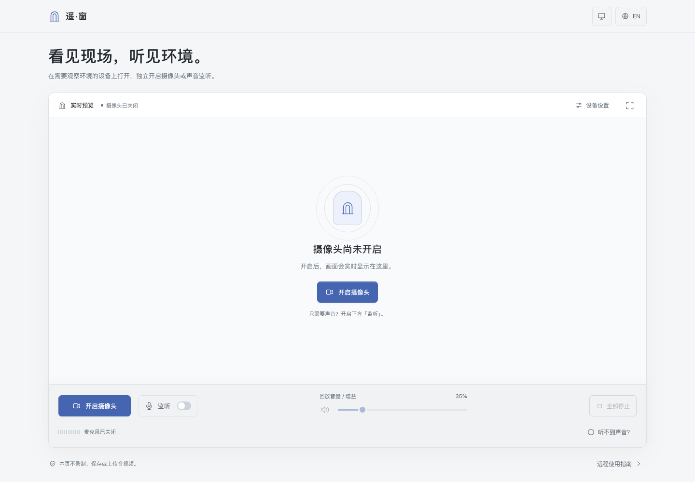

# 遥·窗（Ambient Portal）

**看见现场，听见环境。**

[English](README.en.md) · 简体中文

[在线使用](https://hanglark.github.io/ambient-portal/) · [GitHub 仓库](https://github.com/HangLark/ambient-portal)


<details>
<summary>查看浅色主题</summary>



</details>

**遥·窗（Ambient Portal）** 是一个轻量的网页工具，让你通过远程桌面看见现场、听见环境。在被控设备上打开网页，通过摄像头查看周围画面，通过麦克风监听环境声音；屏幕与系统声音的远程转发由 UU 远程等远程控制软件负责。

Vite + 原生 JavaScript + 浏览器 Web API。无后端、账号、数据库或生产运行时依赖，不录制、不保存、不上传音视频。仅在当前浏览器 `localStorage` 中保存语言、外观、画面比例和播放前提醒偏好。

## 功能

- 摄像头直连实时预览、全屏查看；默认优先设备支持的最高原生分辨率，再争取该分辨率下的最高帧率，显示实际采集参数。
- 自动、16:9、4:3、1:1、9:16 画面比例协商；优先原生格式，不支持时保留画面，允许用户明确选择裁切适配。
- 摄像头与麦克风独立开关，一键停止全部采集；刷新、离开网页时释放媒体轨道。
- 预览区自动利用窗口剩余高度，主控制栏在桌面、手机和全屏预览中均可使用；空状态直接开启画面，采集中收起介绍文案。
- 「设备设置」显示实际摄像头和麦克风来源，有多个已授权输入时可独立切换。
- 仅音频模式以真实输入电平为中心；「听不到声音？」按输入、浏览器回放、远程声音转发逐步排查。
- 声音排查按当前状态给出下一步，可直接开启监听、恢复暂停的回放，或将静音恢复到默认 35% 音量。
- 麦克风优先最高采样率、位深与声道数，显示浏览器报告的实际规格；请求关闭回声消除、降噪和自动增益，保留环境原声。
- 低延迟 Web Audio 麦克风回放、真实输入电平、0–200% 回放音量；默认关闭，开启后的初始音量为 35%。
- 默认在首次开启监听前提醒检查被控设备的音频输出；可选择在此浏览器不再提醒，并随时到设备设置中恢复。
- 一键静音回放并恢复原音量；重新开启或切换麦克风时，高于 100% 的增益回到 35%，已静音的回放保持静音。
- 中英双语、浏览器语言检测、偏好持久化，所有状态和错误均本地化。
- 石墨灰与雾蓝配色，支持深色、浅色和自动跟随系统外观；运行、静音与错误状态均有颜色和文字提示。兼容桌面与手机布局、键盘操作及减弱动态效果偏好。
- 权限被拒绝、设备缺失或占用、信号中断、音频暂停等状态的明确提示。
- 支持取消等待中的权限请求；浏览器之后返回的流会立即释放，不会意外重新开启。

## 本地运行

推荐 **Node.js 24 LTS**（最低 22.12）和 npm。项目包含 `.nvmrc`。

```bash
git clone https://github.com/HangLark/ambient-portal.git
cd ambient-portal
npm ci
npm run dev
```

打开终端显示的地址，默认是 `http://127.0.0.1:5173/`。如果已在项目目录，直接从 `npm ci` 开始。

```bash
npm test           # 媒体生命周期、异常处理与双语字典测试
npm run build     # 生成 dist/
npm run preview   # 在本机预览生产构建
```

生产预览地址：`http://127.0.0.1:4173/ambient-portal/`。`preview` 用于本地检查，不是生产服务器。

## 使用方式

1. 在**被控设备**的 Chrome 或 Edge 中打开网页，点击「开启摄像头」，允许浏览器访问摄像头。
2. 需要声音时，开启「监听」，先确认被控设备不会外放。点击「已确认，开启监听」并允许访问麦克风后，本页会将声音送入**被控设备的系统默认音频输出**，供远程软件转发。
3. 如果浏览器暂停音频回放，点击「恢复音频回放」。先使用较低音量，再按需调整。
4. 音量旁的扬声器按钮可立即静音回放，再次点击恢复原音量。麦克风仍在采集，但远程转发也将收不到本页声音。「停止摄像头」只关闭画面；关闭「监听」释放麦克风；「全部停止」释放全部设备。
5. 离开页面或刷新也会停止采集。即使浏览器记住了权限，下次打开仍需要主动开启。

### 外观

点击右上角的外观图标，选择**跟随系统、浅色或深色**。首次使用默认跟随系统，并随系统外观变化自动更新；手动选择后会记住偏好，随时可以改回跟随系统。浏览器禁止本地存储时，选择仍在当前页面会话内有效。

切换主题不会重新启动摄像头或麦克风，不会改变采集质量和回放音量，也不会给实时画面添加滤镜。刷新时会在应用加载前应用偏好，避免短暂闪现另一套配色。

### 采集质量与音量

启动后会读取媒体轨道的 `getCapabilities()`，使用 `applyConstraints()` 优先协商最高规格。摄像头默认优先原生画面；协商完分辨率后，在保持该分辨率的前提下提高帧率。麦克风优先浏览器报告的最高采样率、位深与声道数。能力查询不可用时使用较高的初始偏好；如果驱动拒绝升级，保留已经取得的可用媒体流。

设备能力的范围不代表所有参数组合都可用，因此以页面显示的 `getSettings()` 实际值为准，未报告的字段不会虚构。音频输出设备和浏览器可能重新采样或混合声道；远程软件也可能压缩画面和声音。最高采集规格不等于远程端无损接收。

回放 **100% 为原始信号增益，200% 为 2 倍振幅增益**，不代表人耳感受到的响度翻倍，也不是系统音量。超过 100% 时界面会提示失真和反馈风险；强信号可能削波，请根据听感降低音量。采集规格与回放音量相互独立，默认 35% 回放音量不降低采集质量。

### 播放前检查与静音

默认每次打开或刷新页面，首次开启监听都会提醒避免被控设备外放。可使用远程软件提供的被控端静音功能，或为被控设备接入耳机；远程收听时保持本页回放与声音转发开启。确认前不申请麦克风权限、不播放声音。取消、按 Esc 或点击弹窗外部均不会开启麦克风，也不会保存这次勾选。

弹窗中的**在此浏览器不再提醒**默认不勾选。勾选后点击**已确认，开启监听**才会保存，下次打开或刷新也会记住；未勾选时，确认仅在当前页面有效。到**设备设置 → 麦克风 → 开启监听前提醒**可随时调整。重新开启提醒会在下次主动启动监听前生效，不打断正在进行的监听。如果浏览器无法保存偏好，会明确提示设置仅在当前页面有效。

从「听不到声音？」开启监听也遵循同一偏好。关闭提醒不会自动启动监听，也不会绕过浏览器的麦克风权限。网页无法可靠读取系统静音状态，确认表示用户已检查，不代表网页检测到了静音。

- **临时静音**：点击音量旁的扬声器按钮立即停止回放，摄像头、麦克风与输入电平继续工作；再次点击恢复最近的非零音量，包括本次监听内的 200%。滑块调到 0% 也可用此按钮恢复。排查窗口仍保留恢复到默认 35% 的操作。
- **关闭后重开**：上次回放超过 100% 时，以 35% 重新开启并显示提示；不超过 100% 的音量保留。若关闭时已静音，重开保持静音，且不会在随后取消静音时带回旧的高增益。切换麦克风也遵循此规则。
- **两种静音**：远程软件提供的被控端静音功能可以关闭现场外放，同时保留远程收听；本页的「静音本页回放」则会停止输出这一路声音，远程端也会听不到。页面的「音频输出：被控设备 · 系统默认设备」说明输出路径，不代表现场扬声器一定在发声。

### 画面比例

在「设备设置」中选择**自动 · 画质优先、16:9、4:3、1:1 或 9:16**。摄像头关闭时只保存偏好；采集中会在同一媒体轨道上切换，麦克风不受影响。快速连续选择只执行当前协商和最后一个待处理选项，切换期间也可以停止采集。

- 默认使用 `resizeMode: none` 请求设备提供的格式，在所选比例内优先高分辨率，再提高帧率。比例允许约 1% 偏差，以兼容类似 1760 × 1328 的近似 4:3 原生格式。
- 页面读取 `getSettings()` 核实实际宽高与输出模式。浏览器忽略请求、未报告原生模式或设备不支持时，不会显示虚假的切换成功；会恢复之前的画面和选项。如果恢复也失败，会明确提示并回到自动模式。
- 出现**允许裁切适配**时，点击后才请求 `crop-and-scale`。它可能裁切或缩放画面，不能增加传感器细节。浏览器未提供裁切控制时不显示此按钮。裁切许可不持久化；下次启动仍先尝试原生格式。
- 预览底部显示实际分辨率、帧率、比例和模式。**设备原生模式**仅表示设备、驱动或系统提供的格式，不代表完整传感器画幅或全部 1200 万像素。**浏览器适配**表示浏览器报告了适配模式，不证明每一帧一定发生了裁切。未报告模式时会如实显示。
- 预览使用 `object-fit: contain` 完整展示实际画面，不拉伸或用 CSS 裁切冒充采集比例。刷新后记住比例偏好，但摄像头与麦克风保持关闭；每次启动重新协商，不缓存设备能力或硬编码机型分辨率。

浏览器能力范围无法枚举所有原生格式组合，因此“画质优先”是尽力协商，不保证取得硬件理论最大值。不同摄像头、系统、浏览器或系统相机效果可能产生不同结果，以预览底部的实际参数为准。

### 设备来源与声音排查

点击预览右上角的「设备设置」查看实际输入名称和音频规格。只有浏览器提供多个已授权输入时才显示对应的设备选择器；读取列表不会主动申请采集权限。连接或拔出设备、重新打开设置时会刷新列表。

- 采集中切换摄像头只重启画面，切换麦克风只重启监听，另一通道保持运行。新输入仍按最高质量协商；切换麦克风时应用上述高增益保护，保留静音状态。
- 所选设备不可用时会明确报错，不会自动使用另一台设备。到设置中选择可用输入后主动重试；不可用选项会保留以方便识别。采集关闭时选择设备不会自动开启。
- 设备选择只在当前页面会话内保存，不写入 `localStorage`。设备名称来自浏览器，不保证包含完整硬件型号。
- 只有麦克风开启时，主区域显示监听状态、实际来源和输入电平。音量为 0% 时仍在采集，输入电平仍可响应；停止监听才会释放麦克风。
- 仅声音模式也会显示正在开启、回放静音或信号中断等状态。静音时页面明确提示回放已静音；在「听不到声音？」中可一键恢复到 35%，无需重启采集。排查窗口中的操作都需要主动点击。
- 「暂未检测到明显声音」只表示当前未检测到明显输入，不判定设备故障。输入信号中断、浏览器暂停回放和回放静音分别提示；音频上下文暂停时不伪称正在测量电平。
- 「听不到声音？」会分别列出麦克风、本页回放和控制端收听。**本页回放已开启**只表示浏览器正在输出声音，不保证现场外放或远程收听正常。排查窗口也说明：如果只在被控设备系统静音后无声，需要检查远程软件的静音与输出设置。

### 远程桌面声音转发

遥·窗本身不进行网络推流。在 UU 远程等软件中开启**被控端系统声音转发 / 电脑声音**，控制端才能听到本页回放的麦克风声音。具体功能名、可用性和声音输出设备取决于远程软件与操作系统。

- 本页的「麦克风监听」与远程软件的「系统声音转发」需要同时开启；仅开启远程语音聊天或控制端麦克风，不等同于转发被控端系统声音。
- 麦克风声音先由本页输出，再由远程软件转发。为避免现场外放，可使用远程软件提供的**被控端静音**功能，或为被控设备接入耳机、配置合适的虚拟音频输出。仅给控制端戴耳机不能消除被控端扬声器造成的反馈。
- 默认请求关闭回声消除、降噪和自动增益，尽量保留环境声；实际处理能力依设备和浏览器而异。请避免让播放声音再次进入麦克风，尤其是在放大回放时。
- 保持本页回放开启，并确认浏览器标签页未静音。系统扬声器静音与本页静音作用的位置不同：系统静音是否影响转发，取决于远程软件的采集方式。若仅在系统静音后远程端无声，请检查远程软件的静音与音频输出设置，优先使用其专门提供的被控端静音功能。
- 保持被控设备唤醒、浏览器和网页打开。系统休眠、浏览器后台限制或设备切换可能暂停采集；本页会反映设备或音频中断状态。移动设备后台运行能力由浏览器决定。

### 权限与安全上下文

浏览器只允许在 **HTTPS 或 localhost / 127.0.0.1** 的安全上下文中使用摄像头与麦克风。GitHub Pages 的 HTTPS 地址符合这一要求。

- 直接双击 `index.html`，或用普通 HTTP 局域网 IP 访问，不是受支持的部署方式。手机调试优先使用已部署的 HTTPS 地址。
- 首次使用时允许浏览器弹窗；如果拒绝，打开地址栏的网站权限设置重新允许，再重试。
- 同时检查操作系统对浏览器的摄像头、麦克风授权，以及设备是否被其他应用独占。
- 优先支持最新版 Chrome、Edge。其他浏览器会尽力运行，但全屏、权限查询、音频回放及后台行为可能不同。
- 无需为网页关闭浏览器安全策略，也不需要配置服务器权限代理。

## GitHub Pages 部署

预期地址：**`https://<username>.github.io/ambient-portal/`**。

工作流已在 [`.github/workflows/deploy.yml`](.github/workflows/deploy.yml) 中配置。每次推送到 `main` 会执行：

1. 检出代码，设置 Node.js 24，使用 npm 缓存。
2. `npm ci` 安装锁定依赖。
3. `npm test` 验证媒体生命周期与双语逻辑。
4. `npm run build` 构建静态文件。
5. 上传 `dist/`，通过官方 GitHub Pages Actions 发布。

也可以从 **Actions → Deploy Ambient Portal to GitHub Pages → Run workflow** 手动触发。

### 需要在 GitHub 手动完成的一次性设置

1. 创建或使用名为 **`ambient-portal`** 的仓库，把项目推送到 **`main`**。使用 GitHub Free 免费托管时，仓库需为 **Public**；私有仓库的 Pages 可用性取决于 GitHub 套餐。
2. 打开 **Settings → Pages → Build and deployment**，将 **Source** 设为 **GitHub Actions**。无需创建 `gh-pages` 分支。
3. 在 **Settings → Actions → General** 确认允许运行此仓库的 Actions，并允许工作流所用的官方 `actions/*`。工作流已按 job 声明 `contents: read`、`pages: write`、`id-token: write`，无需创建 PAT 或添加部署密钥。
4. 如果仓库的 **Settings → Environments → github-pages** 有保护规则，允许 `main` 部署；如配置了人工审批，需要在部署任务中批准。普通仓库可以保留默认设置。
5. 推送一次代码，或手动运行工作流。等待 build 与 deploy 两个任务成功后，在 **Settings → Pages** 打开公布的 HTTPS 地址。确认 **Enforce HTTPS** 已启用（默认 `github.io` 域名会使用 HTTPS）。

若你已有空远程仓库，首次推送可使用：

```bash
# 如果当前目录尚未初始化 Git：git init -b main
git add .
git commit -m "Build Ambient Portal"
git remote add origin https://github.com/<username>/ambient-portal.git
git push -u origin main
```

如项目已提交，跳过 `git add` 和 `git commit`；如已有 `origin`，无需再次添加。

### 路径与刷新

[`vite.config.js`](vite.config.js) 将开发服务器的 `base` 设为 `/`，构建和生产预览设为 `/ambient-portal/`。JS、CSS、图标均经 Vite 正确处理，可在 GitHub Pages 项目子目录加载。本应用没有客户端路由，在 `/ambient-portal/` 刷新会直接返回 `index.html`，无需 404 路由补丁。

如果将来更换仓库名、部署为用户根站点或配置自定义域名，需要对应修改 `base`。当前配置专用于请求中的 `ambient-portal` 项目路径。

### 部署验收

- Actions 的 build、deploy 成功，Pages URL 返回页面。
- 直接访问及刷新 `/ambient-portal/`，无 JS / CSS / SVG 404。
- 在 HTTPS 页面主动授权后，画面可用，麦克风独立监听可用，停止后浏览器设备指示结束。
- 切换语言或外观后刷新，偏好保留，设备保持关闭；跟随系统模式随系统外观变化更新。
- 远程软件系统声音转发开启后，控制端能听到被控端回放的声音。

本地的生产构建和合成设备浏览器测试不能代替你所在仓库实际的 Actions 运行、实体设备权限，以及远程软件音频链路检查。

## 浏览器验证

项目提供 Playwright 测试，默认使用本机安装的 Google Chrome，使用**合成摄像头和麦克风**，不会打开实体采集设备。

```bash
npm run test:e2e
```

对已经部署的 HTTPS 网站运行相同的测试（不会启动本地服务器）：

```bash
AMBIENT_TEST_URL=https://hanglark.github.io/ambient-portal/ npm run test:e2e
```

Windows PowerShell：先设置 `$env:AMBIENT_TEST_URL="https://hanglark.github.io/ambient-portal/"`，再运行 `npm run test:e2e`。

没有 Chrome 时可使用 Playwright Chromium：

```bash
npx playwright install chromium
PLAYWRIGHT_CHROMIUM=1 npm run test:e2e
```

Windows PowerShell 对应设置：`$env:PLAYWRIGHT_CHROMIUM="1"`，然后运行 `npm run test:e2e`。

测试会启动生产预览，检查 `/ambient-portal/` 的资源与刷新、最高采集规格与实际参数显示、比例切换与裁切确认、连续请求与取消、200% 回放增益、摄像头 / 麦克风独立控制、轨道释放、权限错误与重试、偏好持久化、键盘选择器和对话框，以及 1440 / 390 / 320 像素宽度下的双语布局。还验证 1366 × 768 首屏控制、手机和全屏中的操作可达性、设备来源切换及断开恢复、仅音频界面、安静/静音/输入中断/回放暂停的排查状态。单元测试另覆盖设备列表竞态、快速切换和迟到流释放，以及驱动忽略约束、恢复失败及能力 API 缺失。截图保存在 `test-results/`。

外观测试还覆盖系统主题变化、手动选择与刷新恢复、应用脚本加载前的配色、本地存储受限、双主题下的双语布局与对话框，以及切换主题时保持采集、画面比例和回放增益。

声音排查测试验证窗口内开启监听、0% 静音恢复到 35% 的实际增益、键盘焦点，以及取消麦克风开启后的迟到流释放。点击顶部品牌只跳转到页首，不会重新加载或中断采集。

播放前提醒测试覆盖默认提醒、勾选后取消不保存、跨刷新记住选择、设备设置中恢复提醒、声音排查入口与存储读写受限时的反馈，并检查双语、明暗主题、窄屏和全屏中的布局。

## 代码结构

```text
src/
  main.js          页面结构、状态渲染与交互
  media.js         媒体采集、回放和完整资源生命周期
  camera-format.js 比例协商、串行切换、结果核实与失败恢复
  i18n.js          中英文词典、语言检测与存储
  icons.js         本地 SVG 线性图标
  style.css        双主题响应式界面
public/portal.svg  品牌图标
tests/             生命周期与浏览器测试
.github/workflows/deploy.yml
```

无媒体持久化、网络 API、第三方字体或分析脚本。画面直接绑定到静音 `<video>`；麦克风走 `MediaStream → AnalyserNode → GainNode → AudioContext.destination`，无需编码、录制或网络往返。网页的正常静态资源请求仍由部署平台提供。

部署与浏览器行为参考：[Vite 静态部署](https://vite.dev/guide/static-deploy.html#github-pages)、[GitHub Pages 自定义工作流](https://docs.github.com/en/pages/getting-started-with-github-pages/using-custom-workflows-with-github-pages)、[MDN getUserMedia](https://developer.mozilla.org/en-US/docs/Web/API/MediaDevices/getUserMedia)、[MDN AudioContext](https://developer.mozilla.org/en-US/docs/Web/API/AudioContext)。

采集与增益参考：[MDN getCapabilities](https://developer.mozilla.org/en-US/docs/Web/API/MediaStreamTrack/getCapabilities)、[MDN applyConstraints](https://developer.mozilla.org/en-US/docs/Web/API/MediaStreamTrack/applyConstraints)、[MDN getSettings](https://developer.mozilla.org/en-US/docs/Web/API/MediaStreamTrack/getSettings)、[MDN GainNode.gain](https://developer.mozilla.org/en-US/docs/Web/API/GainNode/gain)。

设备选择参考：[MDN deviceId](https://developer.mozilla.org/en-US/docs/Web/API/MediaTrackConstraints/deviceId)、[MDN devicechange](https://developer.mozilla.org/en-US/docs/Web/API/MediaDevices/devicechange_event)。
