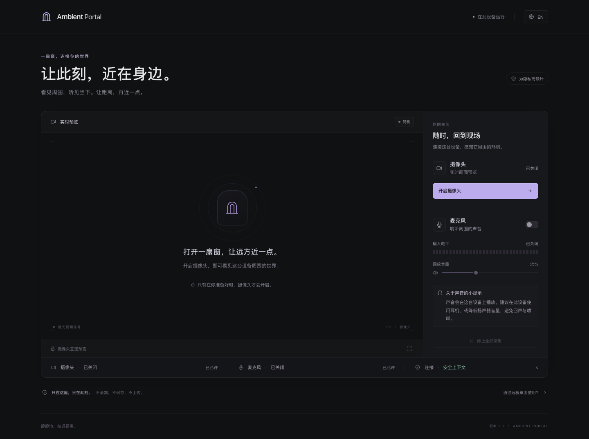

# Ambient Portal

**让此刻，近在身边。**

[English](README.en.md) · 简体中文



Ambient Portal 是一个轻量的纯前端环境感知工具。在被控设备上打开网页，就能通过摄像头观察周围，通过麦克风监听环境声音。配合 UU 远程等远程桌面软件的屏幕与系统声音转发，在另一台设备上也能感知现场。

Vite + 原生 JavaScript + 浏览器 Web API。无后端、账号、数据库或生产运行时依赖，不录制、不保存、不上传音视频。唯一持久化的数据是保存在当前浏览器 `localStorage` 中的语言偏好。

## 功能

- 摄像头直连实时预览、全屏查看；默认请求 1280 × 720、30 fps，设备能力优先，不强制分辨率。
- 摄像头与麦克风独立开关，一键停止全部采集；刷新、离开网页时释放媒体轨道。
- 低延迟 Web Audio 麦克风回放、真实输入电平、可调回放音量；默认关闭，开启后的初始音量为 35%。
- 中英双语、浏览器语言检测、偏好持久化，所有状态和错误均本地化。
- 精致的深色界面、桌面与手机布局、键盘操作、减弱动态效果偏好支持。
- 权限被拒绝、设备缺失或占用、信号中断、音频暂停等状态的明确提示。
- 支持取消等待中的权限请求；浏览器之后返回的流会立即释放，不会意外重新开启。

## 本地运行

推荐 **Node.js 24 LTS**（最低 22.12）和 npm。项目包含 `.nvmrc`。

```bash
git clone https://github.com/<username>/ambient-portal.git
cd ambient-portal
npm ci
npm run dev
```

打开终端显示的地址，默认是 `http://127.0.0.1:5173/`。如果已在项目目录，直接从 `npm ci` 开始。

```bash
npm test           # 媒体生命周期、异常处理与双语字典测试
npm run build     # 生成 dist/
npm run preview   # 在本机预览生产构建
```

生产预览地址：`http://127.0.0.1:4173/ambient-portal/`。`preview` 用于本地检查，不是生产服务器。

## 使用方式

1. 在**被控设备**的 Chrome 或 Edge 中打开网页，点击「开启摄像头」，允许浏览器访问摄像头。
2. 需要声音时，独立开启「麦克风监听」。允许访问麦克风后，声音会从**被控设备当前浏览器的音频输出**播放。
3. 如果浏览器暂停音频回放，点击「恢复音频回放」。先使用较低音量，再按需调整。
4. 「停止摄像头」只关闭画面；麦克风开关只关闭监听；「停止全部采集」释放全部设备。
5. 离开页面或刷新也会停止采集。即使浏览器记住了权限，下次打开仍需要主动开启。

### 远程桌面声音转发

Ambient Portal 本身不进行网络推流。在 UU 远程等软件中开启**被控端系统声音转发 / 电脑声音**，控制端才能听到本页回放的麦克风声音。具体功能名、可用性和声音输出设备取决于远程软件与操作系统。

- 本页的「麦克风监听」与远程软件的「系统声音转发」需要同时开启；仅开启远程语音聊天或控制端麦克风，不等同于转发被控端系统声音。
- 声音会在被控端播放。建议为**被控设备**接入耳机，或配置远程软件能够采集的虚拟音频输出，避免麦克风收进扬声器声音形成回声或啸叫。仅给控制端戴耳机不能消除被控端反馈。
- 默认开启浏览器的回声消除和降噪，关闭自动增益；效果依设备而异，不能保证完全消除反馈，也可能减弱部分环境声。
- 将被控设备或浏览器静音，可能也让远程转发无声。检查浏览器、系统音量和远程软件的声音设置；先以低音量确认链路。
- 保持被控设备唤醒、浏览器和网页打开。系统休眠、浏览器后台限制或设备切换可能暂停采集；本页会反映设备或音频中断状态。移动设备后台运行能力由浏览器决定。

### 权限与安全上下文

浏览器只允许在 **HTTPS 或 localhost / 127.0.0.1** 的安全上下文中使用摄像头与麦克风。GitHub Pages 的 HTTPS 地址符合这一要求。

- 直接双击 `index.html`，或用普通 HTTP 局域网 IP 访问，不是受支持的部署方式。手机调试优先使用已部署的 HTTPS 地址。
- 首次使用时允许浏览器弹窗；如果拒绝，打开地址栏的网站权限设置重新允许，再重试。
- 同时检查操作系统对浏览器的摄像头、麦克风授权，以及设备是否被其他应用独占。
- 优先支持最新版 Chrome、Edge。其他浏览器会尽力运行，但全屏、权限查询、音频回放及后台行为可能不同。
- 无需为网页关闭浏览器安全策略，也不需要配置服务器权限代理。

## GitHub Pages 部署

预期地址：**`https://<username>.github.io/ambient-portal/`**。

工作流已在 [`.github/workflows/deploy.yml`](.github/workflows/deploy.yml) 中配置。每次推送到 `main` 会执行：

1. 检出代码，设置 Node.js 24，使用 npm 缓存。
2. `npm ci` 安装锁定依赖。
3. `npm test` 验证媒体生命周期与双语逻辑。
4. `npm run build` 构建静态文件。
5. 上传 `dist/`，通过官方 GitHub Pages Actions 发布。

也可以从 **Actions → Deploy Ambient Portal to GitHub Pages → Run workflow** 手动触发。

### 需要在 GitHub 手动完成的一次性设置

1. 创建或使用名为 **`ambient-portal`** 的仓库，把项目推送到 **`main`**。使用 GitHub Free 免费托管时，仓库需为 **Public**；私有仓库的 Pages 可用性取决于 GitHub 套餐。
2. 打开 **Settings → Pages → Build and deployment**，将 **Source** 设为 **GitHub Actions**。无需创建 `gh-pages` 分支。
3. 在 **Settings → Actions → General** 确认允许运行此仓库的 Actions，并允许工作流所用的官方 `actions/*`。工作流已按 job 声明 `contents: read`、`pages: write`、`id-token: write`，无需创建 PAT 或添加部署密钥。
4. 如果仓库的 **Settings → Environments → github-pages** 有保护规则，允许 `main` 部署；如配置了人工审批，需要在部署任务中批准。普通仓库可以保留默认设置。
5. 推送一次代码，或手动运行工作流。等待 build 与 deploy 两个任务成功后，在 **Settings → Pages** 打开公布的 HTTPS 地址。确认 **Enforce HTTPS** 已启用（默认 `github.io` 域名会使用 HTTPS）。

若你已有空远程仓库，首次推送可使用：

```bash
# 如果当前目录尚未初始化 Git：git init -b main
git add .
git commit -m "Build Ambient Portal"
git remote add origin https://github.com/<username>/ambient-portal.git
git push -u origin main
```

如项目已提交，跳过 `git add` 和 `git commit`；如已有 `origin`，无需再次添加。

### 路径与刷新

[`vite.config.js`](vite.config.js) 将开发服务器的 `base` 设为 `/`，构建和生产预览设为 `/ambient-portal/`。JS、CSS、图标均经 Vite 正确处理，可在 GitHub Pages 项目子目录加载。本应用没有客户端路由，在 `/ambient-portal/` 刷新会直接返回 `index.html`，无需 404 路由补丁。

如果将来更换仓库名、部署为用户根站点或配置自定义域名，需要对应修改 `base`。当前配置专用于请求中的 `ambient-portal` 项目路径。

### 部署验收

- Actions 的 build、deploy 成功，Pages URL 返回页面。
- 直接访问及刷新 `/ambient-portal/`，无 JS / CSS / SVG 404。
- 在 HTTPS 页面主动授权后，画面可用，麦克风独立监听可用，停止后浏览器设备指示结束。
- 中英切换后刷新，偏好保留，设备保持关闭。
- 远程软件系统声音转发开启后，控制端能听到被控端回放的声音。

本地的生产构建和合成设备浏览器测试不能代替你所在仓库实际的 Actions 运行、实体设备权限，以及远程软件音频链路检查。

## 浏览器验证

项目提供 Playwright 测试，默认使用本机安装的 Google Chrome，使用**合成摄像头和麦克风**，不会打开实体采集设备。

```bash
npm run test:e2e
```

没有 Chrome 时可使用 Playwright Chromium：

```bash
npx playwright install chromium
PLAYWRIGHT_CHROMIUM=1 npm run test:e2e
```

Windows PowerShell 对应设置：`$env:PLAYWRIGHT_CHROMIUM="1"`，然后运行 `npm run test:e2e`。

测试会启动生产预览，检查 `/ambient-portal/` 的资源与刷新、摄像头 / 麦克风独立控制、轨道释放、权限错误与重试、语言持久化、键盘对话框，以及 1440 / 390 / 320 像素宽度下的双语布局。截图保存在 `test-results/`。

## 代码结构

```text
src/
  main.js          页面结构、状态渲染与交互
  media.js         媒体采集、回放和完整资源生命周期
  i18n.js          中英文词典、语言检测与存储
  icons.js         本地 SVG 线性图标
  style.css        响应式深色界面
public/portal.svg  品牌图标
tests/             生命周期与浏览器测试
.github/workflows/deploy.yml
```

无媒体持久化、网络 API、第三方字体或分析脚本。画面直接绑定到静音 `<video>`；麦克风走 `MediaStream → AnalyserNode → GainNode → AudioContext.destination`，无需编码、录制或网络往返。网页的正常静态资源请求仍由部署平台提供。

部署与浏览器行为参考：[Vite 静态部署](https://vite.dev/guide/static-deploy.html#github-pages)、[GitHub Pages 自定义工作流](https://docs.github.com/en/pages/getting-started-with-github-pages/using-custom-workflows-with-github-pages)、[MDN getUserMedia](https://developer.mozilla.org/en-US/docs/Web/API/MediaDevices/getUserMedia)、[MDN AudioContext](https://developer.mozilla.org/en-US/docs/Web/API/AudioContext)。
